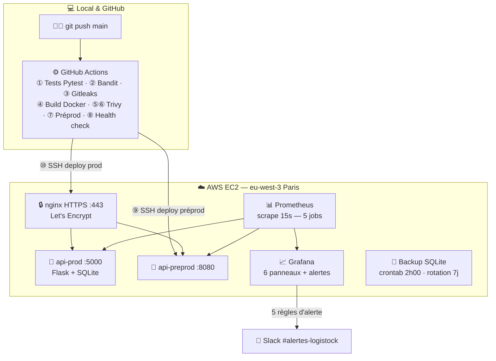

# LogiStock — Infrastructure DevSecOps sur AWS

Application de gestion d'inventaire (EPI) déployée sur AWS avec un pipeline
CI/CD à 11 étapes DevSecOps, supervision Prometheus/Grafana et IaC Terraform/Ansible.

- **Production** : https://logistock.duckdns.org
- **Préprod** : https://logistock-preprod.duckdns.org
- **Grafana** : https://logistock-grafana.duckdns.org

---

## Architecture



---

## Stack technique

| Composant | Technologie |
|---|---|
| Application | Python 3.13 / Flask / SQLite |
| Conteneurisation | Docker + Docker Compose v2.24.0 |
| Reverse proxy | nginx + Let's Encrypt (HTTPS :443) |
| CI/CD | GitHub Actions — 11 étapes DevSecOps |
| Sécurité SAST | Bandit (-lll -iii) + Gitleaks |
| Sécurité image | Trivy (CVE CRITICAL/HIGH + secrets) |
| IaC | Terraform (VPC + SG + EC2) + Ansible |
| Cloud | AWS EC2 t3.micro Free Tier — eu-west-3 (Paris) |
| OS serveur | Amazon Linux 2023 |
| Supervision | Prometheus + Grafana + node-exporter + blackbox-exporter |
| Alertes | 5 règles Prometheus → Alertmanager → Slack |
| Sauvegarde | Script Bash + crontab 2h00 — rotation 7j |

---

## Structure du projet

```
projet-logistock/
├── .github/
│   └── workflows/
│       └── main.yml              ← Pipeline CI/CD DevSecOps (11 étapes)
├── app.py                        ← API Flask (routes, métriques Prometheus)
├── test_app.py                   ← 15 tests automatisés (Pytest)
├── Dockerfile                    ← Image python:3.13-slim + HEALTHCHECK
├── requirements.txt
├── docker-compose.yml            ← 6 services : prod, préprod, prometheus,
│                                    grafana, node-exporter, blackbox-exporter
├── prometheus.yml                ← Configuration scraping (5 jobs, 15s)
├── alerts.yml                    ← 5 règles d'alerte Prometheus
├── grafana/
│   └── provisioning/
│       ├── dashboards/logistock.json
│       ├── datasources/prometheus.yml
│       └── alerting/
│           ├── contact-points.yaml
│           └── notification-policies.yaml
├── nginx/logistock.conf          ← Reverse proxy HTTPS
├── backup.sh                     ← Sauvegarde SQLite + rotation 7j
├── provision.sh                  ← Provisionnement Bash + AWS CLI
├── provision-https.sh            ← nginx + certbot Let's Encrypt
├── terraform/main.tf             ← VPC + Security Group + EC2
└── ansible/playbook.yml          ← Docker + Compose sur le serveur
```

---

## Déploiement

### Prérequis

```bash
aws configure   # AWS CLI configuré avec tes credentials
ssh-keygen -t rsa -b 2048 -f logistock-key.pem -N ""
aws ec2 import-key-pair \
  --key-name logistock-key \
  --region eu-west-3 \
  --public-key-material fileb://logistock-key.pem.pub
```

### Option A — Bash (utilisé en production)

```bash
chmod +x provision.sh && ./provision.sh
ansible-playbook -i <IP_EC2>, -u ec2-user \
  --private-key logistock-key.pem ansible/playbook.yml
chmod +x provision-https.sh && ./provision-https.sh
```

### Option B — Terraform + Ansible (recommandé en équipe)

```bash
cd terraform/
terraform init
terraform apply -var admin_cidr="<TON_IP>/32"
ansible-playbook -i <IP_EC2>, -u ec2-user \
  --private-key ../logistock-key.pem ../ansible/playbook.yml
```

**Secrets GitHub à configurer (Settings → Secrets) :**

| Secret | Valeur |
|---|---|
| `AWS_HOST_IP` | IP publique de l'EC2 |
| `AWS_SSH_KEY` | Contenu de la clé privée PEM |
| `SLACK_WEBHOOK_URL` | Webhook Grafana → Slack |

---

## Pipeline CI/CD — 11 étapes DevSecOps

Déclenché automatiquement à chaque `git push main`. Si une étape échoue, le déploiement est bloqué.

| # | Étape | Outil | Bloquant |
|---|---|---|---|
| 1 | Checkout du code | actions/checkout | — |
| 2 | Tests automatisés | Pytest (15 cas) | Oui |
| 3 | Analyse SAST Python | Bandit (-lll -iii) | Oui |
| 4 | Détection de secrets Git | Gitleaks | Oui |
| 5 | Build de l'image Docker | docker build | Oui |
| 6 | Scan CVE image | Trivy (CRITICAL/HIGH) | Oui |
| 7 | Scan secrets image | Trivy secrets | Oui |
| 8 | Déploiement préprod | SSH → :8080 | Oui |
| 9 | Health check préprod | curl /health → HTTP 200 | Oui |
| 10 | Déploiement prod | SSH → :5000 | Oui |
| 11 | Nettoyage images | docker image prune | Non |

**15 runs réalisés — dernier run vert ✅**

---

## Services Docker — 6 conteneurs

| Service | Port | Rôle |
|---|---|---|
| api-prod | :5000 | Flask Production — CRUD articles EPI |
| api-preprod | :8080 | Flask Préprod — validation avant mise en prod |
| prometheus | interne | Collecte métriques toutes les 15s — 5 jobs |
| grafana | :3000 | Dashboard 6 panneaux + alertes Slack |
| node-exporter | interne | Métriques système CPU / RAM / Disque |
| blackbox-exporter | interne | HTTP probe /health → `probe_success` |

---

## Supervision

### Prometheus — 5 cibles de scrape

| Job | Cible | Métriques |
|---|---|---|
| logistock-prod | :5000/metrics | Métriques Flask production |
| logistock-preprod | :8080/metrics | Métriques Flask préprod |
| node-exporter | :9100 | CPU, RAM, Disque |
| prometheus | localhost:9090 | Auto-supervision |
| blackbox-exporter | /health | probe_success |

### Grafana — 6 panneaux (métriques observées)

| Panneau | Type | Valeur |
|---|---|---|
| CPU (%) | Gauge | 1,35 % |
| RAM (%) | Gauge | 73,3 % |
| Disque (%) | Gauge | 58,1 % |
| Requêtes HTTP total | Stat | 1 187 requêtes |
| Latence moyenne | Time series | 0,0003 s |
| Latence P95 | Time series | 9,5 ms (SLA < 500 ms ✅) |

### 5 règles d'alerte Prometheus → Slack

| Alerte | Condition | Délai | Sévérité | Slack |
|---|---|---|---|---|
| APIIndisponible | `probe_success` == 0 | 1 min | critical | Oui |
| CPUEleve | CPU > 80% | 5 min | warning | Non |
| RAMElevee | RAM > 85% | 5 min | warning | Non |
| DisquePlein | Disque > 90% | 0 min | critical | Oui |
| LatenceElevee | P95 > 500ms | 5 min | warning | Non |

---

## API — Endpoints

| Méthode | Route | Description |
|---|---|---|
| GET | `/` | Interface web — tableau des articles avec filtres |
| GET | `/api/articles` | Liste tous les articles (JSON) |
| POST | `/api/articles` | Ajoute un article |
| PUT | `/api/articles/<id>` | Modifie un article |
| DELETE | `/api/articles/<id>` | Supprime un article |
| GET | `/health` | Health check (pipeline + Grafana) |
| GET | `/metrics` | Métriques Prometheus |

---

## Procédures opérationnelles

### Rollback

```bash
# Via Git (recommandé — déclenche la pipeline)
git revert HEAD
git push origin main

# Manuel sur le serveur
ssh -i logistock-key.pem ec2-user@<IP_EC2>
docker images | grep logistock
docker-compose stop api-prod
docker tag logistock-api:<VERSION_STABLE> logistock-api:latest
docker-compose up -d api-prod
curl http://localhost:5000/health
```

### Restauration de sauvegarde

```bash
docker-compose stop api-prod
cp /home/ec2-user/backups/inventaire_YYYYMMDD_HHMMSS.db \
   /home/ec2-user/projet-logistock/data-prod/inventaire.db
docker-compose start api-prod
curl https://logistock.duckdns.org/health
```

### Sauvegarde automatique

```bash
# Vérifier le crontab
crontab -l
# → 0 2 * * * /home/ec2-user/backup.sh

# Tester manuellement
/home/ec2-user/backup.sh && cat /home/ec2-user/backups/backup.log
```

- Rotation : 7 dernières sauvegardes conservées
- Fenêtre de restauration : 7 jours
- Durée de restauration : < 30 secondes

### Vérification quotidienne (< 2 min)

```bash
docker ps --format "table {{.Names}}\t{{.Status}}"  # conteneurs actifs ?
ls -lh /home/ec2-user/backups/ | tail -5             # dernière sauvegarde OK ?
df -h /                                              # espace disque suffisant ?
```

---

## Limites

- SQLite non adapté à une charge multi-utilisateurs — à migrer vers PostgreSQL
- Single EC2 sans Auto Scaling — pas de haute disponibilité
- Sauvegarde locale sur le même serveur — pas de réplication distante
- Pas de WAF devant nginx
