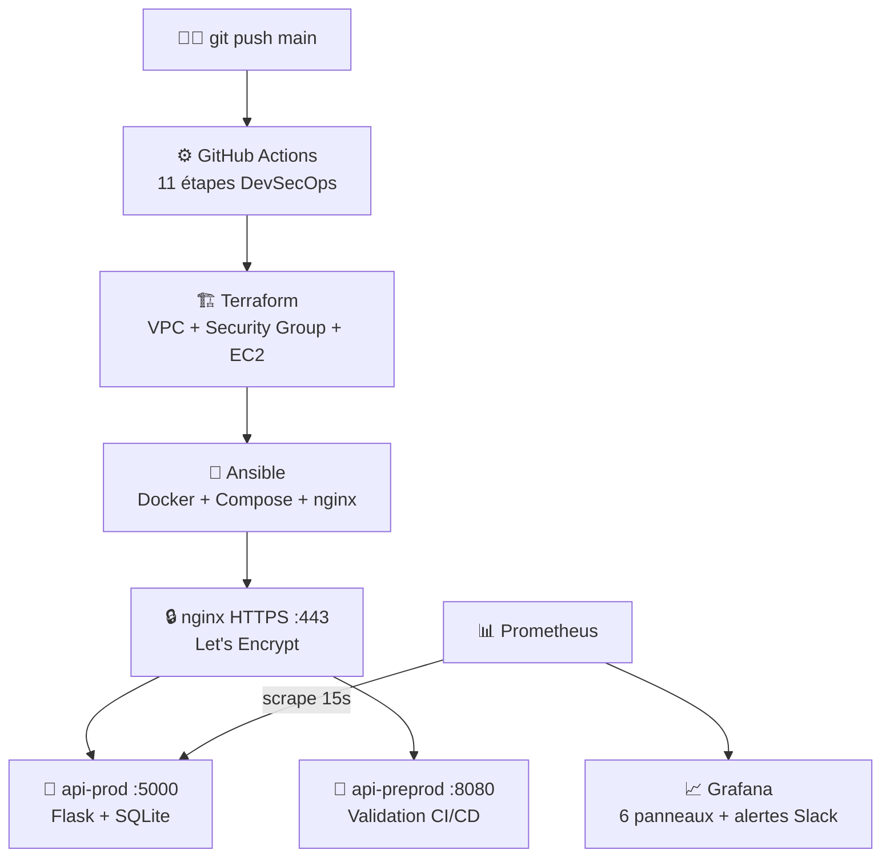

# LogiStock — Infrastructure DevSecOps sur AWS

Application de gestion d'inventaire déployée sur AWS avec un pipeline CI/CD
à 11 étapes DevSecOps, supervision Prometheus/Grafana et IaC Terraform/Ansible.

---

## Architecture



---

## Stack technique

| Composant | Technologie |
|---|---|
| Application | Python 3.13 / Flask / SQLite |
| Conteneurisation | Docker + Docker Compose v2.24.0 |
| Reverse proxy | nginx + Let's Encrypt (HTTPS :443) |
| CI/CD | GitHub Actions — 11 étapes DevSecOps |
| SAST | Bandit (-lll -iii) + Gitleaks |
| Scan image | Trivy (CVE CRITICAL/HIGH + secrets) |
| IaC | Terraform (VPC + SG + EC2) + Ansible |
| Cloud | AWS EC2 t3.micro — eu-west-3 (Paris) |
| OS | Amazon Linux 2023 |
| Supervision | Prometheus + Grafana + node-exporter + blackbox-exporter |
| Alertes | 5 règles Prometheus → Alertmanager → Slack |
| Sauvegarde | Script Bash + crontab 2h00 — rotation 7j |

---

## Pipeline CI/CD — 11 étapes DevSecOps

Déclenché automatiquement à chaque push sur `main`. Si une étape échoue, le déploiement est bloqué.

| # | Étape | Outil | Bloquant |
|---|---|---|---|
| 1 | Checkout | actions/checkout | — |
| 2 | Tests automatisés | Pytest (15 cas) | Oui |
| 3 | Analyse SAST | Bandit (-lll -iii) | Oui |
| 4 | Détection de secrets | Gitleaks | Oui |
| 5 | Build image Docker | docker build | Oui |
| 6 | Scan CVE image | Trivy CRITICAL/HIGH | Oui |
| 7 | Scan secrets image | Trivy secrets | Oui |
| 8 | Déploiement préprod | SSH → :8080 | Oui |
| 9 | Health check préprod | curl /health → HTTP 200 | Oui |
| 10 | Déploiement prod | SSH → :5000 | Oui |
| 11 | Nettoyage images | docker image prune | Non |

**15 runs réalisés — dernier run vert ✅**

---

## Déploiement

### Prérequis

```bash
aws configure   # AWS CLI configuré
ssh-keygen -t rsa -b 2048 -f logistock-key.pem -N ""
aws ec2 import-key-pair \
  --key-name logistock-key \
  --region eu-west-3 \
  --public-key-material fileb://logistock-key.pem.pub
```

### Option A — Bash

```bash
chmod +x provision.sh && ./provision.sh
ansible-playbook -i <IP_EC2>, -u ec2-user \
  --private-key logistock-key.pem ansible/playbook.yml
```

### Option B — Terraform + Ansible (recommandé en équipe)

```bash
cd terraform/
terraform init
terraform apply -var admin_cidr="<TON_IP>/32"
ansible-playbook -i <IP_EC2>, -u ec2-user \
  --private-key ../logistock-key.pem ../ansible/playbook.yml
```

**Secrets GitHub requis :**
- `AWS_HOST_IP` : IP publique de l'EC2
- `AWS_SSH_KEY` : contenu de la clé privée PEM
- `SLACK_WEBHOOK_URL` : webhook Grafana → Slack

---

## Supervision — Métriques observées

| Panneau Grafana | Valeur |
|---|---|
| CPU | 1,35 % |
| RAM | 73,3 % |
| Disque | 58,1 % |
| Requêtes HTTP total | 1 187 |
| Latence moyenne | 0,0003 s |
| Latence P95 | 9,5 ms (SLA < 500 ms ✅) |

### 5 règles d'alerte

| Alerte | Condition | Sévérité |
|---|---|---|
| APIIndisponible | probe_success == 0 | critical |
| CPUEleve | CPU > 80% | warning |
| RAMElevee | RAM > 85% | warning |
| DisquePlein | Disque > 90% | critical |
| LatenceElevee | P95 > 500ms | warning |

---

## API

| Méthode | Route | Description |
|---|---|---|
| GET | `/` | Interface web |
| GET | `/api/articles` | Liste tous les articles |
| POST | `/api/articles` | Ajoute un article |
| PUT | `/api/articles/<id>` | Modifie un article |
| DELETE | `/api/articles/<id>` | Supprime un article |
| GET | `/health` | Health check |
| GET | `/metrics` | Métriques Prometheus |

---

## Procédures opérationnelles

### Rollback

```bash
git revert HEAD && git push origin main
# GitHub Actions redéploie automatiquement
```

### Restauration de sauvegarde

```bash
docker-compose stop api-prod
cp /home/ec2-user/backups/inventaire_YYYYMMDD_HHMMSS.db \
   /home/ec2-user/projet-logistock/data-prod/inventaire.db
docker-compose start api-prod
```

### Vérification quotidienne

```bash
docker ps --format "table {{.Names}}\t{{.Status}}"
ls -lh /home/ec2-user/backups/ | tail -5
df -h /
```

---

## Limites

- SQLite non adapté à une charge multi-utilisateurs importante — à migrer vers PostgreSQL
- Single EC2 sans Auto Scaling — pas de haute disponibilité
- Sauvegarde locale sur le même serveur — pas de réplication distante
- Pas de WAF devant nginx
